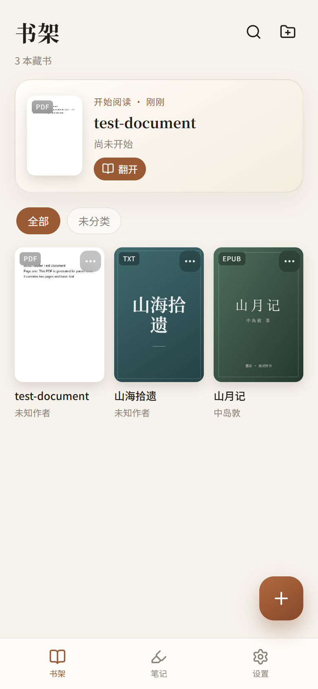
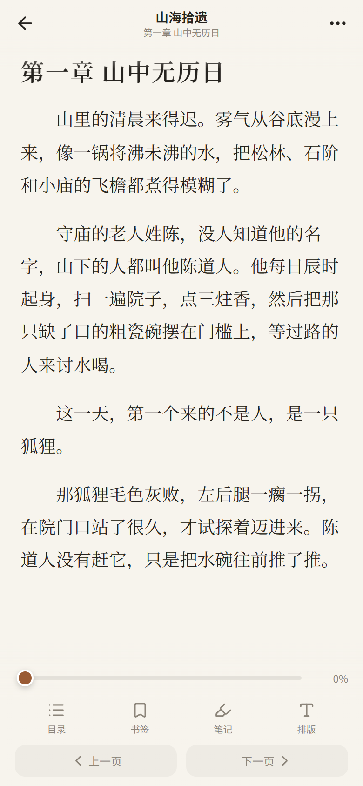
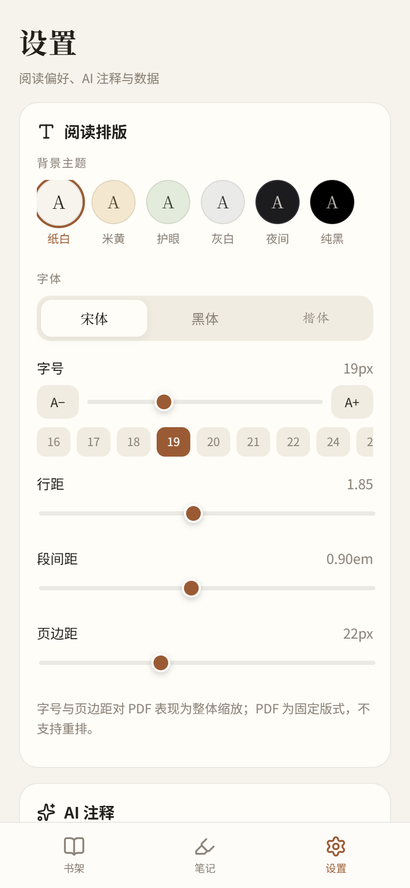

# 墨读 · 安卓电子书阅读器

一个可以在安卓手机上离线使用的电子书阅读器，基于 **Capacitor 8 + React 19 + TypeScript**，同一份代码既能在浏览器里开发调试，也能打包成原生 APK。





| 设置 | 笔记 |
| --- | --- |
|  |  |

## 功能

| 需求 | 实现 |
| --- | --- |
| 多格式 | EPUB（epub.js）、PDF（pdf.js）、TXT（编码探测 + 章节正则）、MOBI / AZW3 / KF8（本地解析器） |
| 章节与封面 | 读取 EPUB 目录 / PDF 大纲 / MOBI TOC；封面提取失败时按书名生成排版封面 |
| 排版 | 6 套主题（纸白、米黄、护眼、灰白、夜间、纯黑）、内置宋体（Noto Serif SC）/ 黑体 / 楷体（LXGW WenKai）、字号、行距、段距、页边距 |
| 书架分类 | 自建分类、批量归类、按分类 / 未分类筛选、搜索、长按操作 |
| 最近阅读 | 首页「继续阅读」卡片显示上次读的书、章节和进度 |
| 阅读进度 | 每次翻页防抖保存，重新打开自动跳回上次位置（EPUB 用 CFI，PDF 用页码，TXT/MOBI 用章节 + 偏移） |
| 书签 | 当前页一键加书签，书签列表可跳转 / 删除 |
| 高亮与笔记 | 选中文字 → 四色高亮或写笔记，重新打开仍然可见，笔记页可统一查看；选择栏同时提供复制、分享、全选、网页搜索 |
| 选择栏 | 长按选字后收起系统选择菜单，只保留应用选择栏（复制 / 分享 / 全选 / 网页搜索 / 高亮 / 笔记 / AI）；轻触空白处关闭 |
| AI 注释 | 选中文字 → DeepSeek 结合上下文（默认 Bing 联网结果，可选 Tavily）生成注释，自动保存为笔记；面板内可继续追问，问答一并保存；模型强度默认 Low |
| AI 自动分类 | 每次导入图书后由 DeepSeek 判断类型并自动创建 / 归入分类；无 Key 或失败时退回本地关键词规则 |
| 批量管理 | 书架右上角「⋮」：批量导入多本书（队列状态）、从文件夹批量导入、AI 批量分类（仅未分类 / 全部重新分类，带进度与停止按钮） |
| 文件夹导入 | 原生 SAF 插件选择整个文件夹，列出其中全部 EPUB/PDF/TXT/MOBI/AZW3，确认后逐本导入；超过 80MB 的文件自动跳过 |
| 滑动翻页 | 阅读时左右滑动翻页；EPUB 的滑动监听注入 iframe 内部，TXT/MOBI/PDF 同样支持；长按选字或已有选区时自动禁用滑动，避免选字时误翻页 |
| 翻页动画 | 新页渲染完成后再入场：横向 18px + 淡入，0.24s 缓出曲线；EPUB / PDF 在翻页完成后触发，TXT 在跨章节时触发，避免旧页先动一下再跳新页；系统开启“减少动态效果”时自动关闭 |
| 页数统计 | 按当前字体、字号、行距、页边距统计全书页数与当前页；PDF 为精确页数，EPUB/TXT/MOBI 为按排版估算并标「约」 |
| 音量键翻页 | 阅读界面按音量上 / 下键翻页，可在「设置」里关闭以恢复系统音量调节 |
| 沉浸式状态栏 | 阅读区域从状态栏下方开始，另加同色遮罩兜底，正文不会钻到状态栏 / 挖孔下面；轻触屏幕中部呼出/收起工具栏（顶部栏、进度、目录/书签/笔记、翻页按钮） |
| 阅读设置 | 字体、字号、主题等统一在底部「设置」页调整，阅读页不再弹出排版预览面板 |

## 目录结构

```
src/
  ai/                DeepSeek 请求、联网搜索、注释提示词
  components/        封面、底部弹层、阅读排版设置、AI 设置
  db/                Dexie(IndexedDB) 表结构与仓储层
  lib/               文本分章、编码识别、格式探测、封面生成、主题
  parsers/           epub / pdf / txt / mobi 解析与导入
  reader/            三种渲染引擎（EPUB、PDF、TXT/MOBI）与统一接口
  pages/             书架、阅读器、笔记、设置
  vendor/            修复过的 MOBI/KF8 解析器（上游 bug 见下方）
android/             Capacitor 原生工程
tests/unit/          Vitest 单元测试
tests/e2e/           Playwright 端到端测试
fixtures/            测试样书（EPUB / TXT / PDF）与生成的素材
tools/               环境安装与 APK 构建脚本
```

## 开发

```bash
npm install
npm run fixtures   # 生成测试样书（EPUB / TXT / PDF，均为脚本合成）
npm run dev        # http://127.0.0.1:5173
npm test           # 单元测试（Vitest + fake-indexeddb）
npm run e2e        # 端到端测试（Playwright，使用本机 Edge）
npm run build      # 类型检查 + 生产构建
```

## 构建安卓 APK

本机环境（脚本按此路径写死，可按需修改 `tools/build-apk.ps1`）：

- JDK 21：`D:\android-dev\jdk-21`
- Android SDK：`D:\android-dev\sdk`（platform 36、build-tools 36、platform-tools）

首次安装 SDK 可运行 `tools/setup-android.ps1`（下载 JDK 21、commandline-tools、platform 35/36；Gradle 使用腾讯云镜像）。

```powershell
powershell -ExecutionPolicy Bypass -File tools/build-apk.ps1
```

产物：`dist-apk/modu-reader-v0.1.0-debug.apk`（debug 签名，可直接侧载安装）。首次安装需要在手机设置里允许「安装未知来源应用」；如需上架或长期分发，自行生成 keystore 并改为 release 签名。

安装到手机：

```powershell
adb install -r "dist-apk\modu-reader-v0.1.0-debug.apk"
```

## AI 注释配置

进入「设置 → AI 注释」：

1. 填入 DeepSeek API Key（`sk-...`），接口地址默认 `https://api.deepseek.com`，模型默认 `deepseek-chat`。
2. 联网搜索默认使用 **Bing**：填入 Azure 门户创建的 Bing Search API Key 后，注释会先检索资料再交给 DeepSeek；不填 Key 时自动退化为只用模型知识（DeepSeek Chat API 本身不含联网）。
3. 「导入时自动分类」默认开启：每本新书由 DeepSeek 从固定分类表（小说、文学、历史、哲学、社科、科普、计算机、经济、心理、传记、艺术、教育、生活、其他）中选一个并自动归类；没有 API Key 或请求失败时使用本地关键词规则，导入不会被阻塞。
4. 已有藏书可以在书架右上角「⋮ → 批量管理」里补做分类：只处理未分类，或全部重新分类（会覆盖原分类）。
5. 阅读时选中文字 → 底部工具栏「AI」→ 等待注释生成，结果自动保存为蓝色高亮笔记。
6. 注释面板下方可以直接追问，例如「这里的隐喻是什么？」。追问会带着原文、已有注释和历史问答继续请求 DeepSeek，回答与问答记录一并写回笔记。
7. 「设置 → AI 注释 → 模型强度」控制注释与追问的详细程度：Low（默认，约 120 字内）、Medium、High。Low 更快，适合边读边问；需要长解释时再切高。

> DeepSeek 的 Chat API 本身不提供联网能力。App 会先用所选搜索服务取回摘要，再连同书名、章节、上下文一起交给 DeepSeek。API Key 只保存在本机 IndexedDB / localStorage，不会上传到第三方。
>
> 浏览器开发模式下请求受 CORS 限制；安卓端通过 CapacitorHttp 走原生请求，不受此影响。

## 格式说明与已知限制

- **AZW3 / KF8**：使用 vendored 的 `@lingo-reader/mobi-parser`（`src/vendor/mobi-parser.mjs`），修复了上游遇到普通 `<link>` 样式表时崩溃的问题。受 DRM 保护的 Kindle 书无法打开。
- **PDF**：固定版式，字号 / 页边距表现为整体缩放，不支持重排；高亮以归一化矩形保存。
- **MOBI/AZW3 图片**：导入时会把章节内图片转成 data URL 一并存入 IndexedDB，因此带大量插图的书会占用较多存储。
- **TXT 章节**：按「第 X 章 / 回 / 卷 / 节、序章、番外、Chapter N」等标题切分；没有标题时按约 6000 字分节。
- 数据全部存放在本机（IndexedDB），卸载 App 会一并清除；暂无云同步 / 导出。
- 未提供 iOS、平板双栏、听书、简繁转换。

## 真机验证

在 Redmi K70 Ultra（Android 16 / WebView 143）上通过 USB 调试 + 系统文件选择器实际验证：

- 从「最近文件 / Download/modu」导入 TXT、EPUB、PDF、25 MB AZW3，封面与章节均正确识别；
- AZW3 打开 75 项目录、书签、划线高亮、笔记，杀进程重开后全部保留；
- EPUB iframe 正文渲染与划线高亮正常；
- PDF 2 页渲染、翻页、页码进度、文本高亮均正常；
- 夜间主题 + 字号调整生效，重启后保持；
- 导入图书、进度、最近阅读卡片在重新安装 / 强杀后仍然存在；
- AI 注释走原生 `CapacitorHttp` 请求 DeepSeek，无效 Key 时正确显示 `HTTP 401` 错误；
- 真实 Key 下：导入《人类简史》后自动归类为「历史」；选中段落生成 AI 注释约 2 秒返回并自动存为笔记；
- 「⋮ → 批量管理」在真机上能调起系统多选文件选择器，批量分类入口按未分类数量自动启用；
- 文件夹导入：选择「书」文件夹后预览到 **107 本、839MB**，自动跳过 5 本超过 80MB 的文件，确认后逐本进入导入队列；
- 滑动翻页：TXT 从第一章滑到第二章、EPUB 在 iframe 内滑动从第一章到第二章均验证通过；
- 音量键：阅读页音量下键翻到下一页、上键回上一页，书架/设置页恢复系统音量；
- 状态栏：阅读区域整体下移到状态栏下方，并叠加同色遮罩，正文不再被时间/挖孔遮挡、翻页后首行完整；
- 轻触：阅读页轻触屏幕中部，工具栏（顶部栏 + 进度 + 目录/书签/笔记 + 翻页按钮）显示/隐藏，不再弹出排版预览面板；字体等设置统一在「设置」页调整。
- 字体：宋体 / 楷体改为内置字体（Noto Serif SC、LXGW WenKai），EPUB 的 iframe 也会注入同一套 @font-face，切换后立刻变成衬线 / 楷体，不再因为系统只有 Noto Sans 而看不出区别；
- 页数：1984 在 22px 时约 639 页、28px 时约 1009 页，底部显示「约 13 / 1009 页 · 1%」；音量键翻页后当前页同步增加；PDF 显示精确页码。

真机上发现并修复了两个问题：`Map.getOrInsertComputed` 在部分 Android WebView 缺失导致 PDF 导入失败（已加 polyfill）；Android 15+ 强制边到边导致状态栏遮挡标题（改用 Capacitor 注入的 `--safe-area-inset-*`）。

## 测试

```bash
npm test    # 26 个单元测试
npm run e2e # 8 个端到端用例：导入解析、排版持久化、书签/划线/笔记/进度、AI 注释（mock）、分类、PDF 高亮、导入时自动分类、批量分类
```

E2E 使用本机已安装的 Edge（`channel: 'msedge'`），无需额外下载浏览器。

## 开源协议

代码以 [MIT License](LICENSE) 开源。

内置字体 [Noto Serif SC](https://fonts.google.com/noto/specimen/Noto+Serif+SC) 与 [LXGW WenKai / 霞鹜文楷](https://github.com/lxgw/LxgwWenKai) 均使用 SIL Open Font License 1.1，随应用一起分发时保留其授权条款。

书源、API Key、个人书架数据都不会进入仓库：API Key 仅保存在本机，测试样书由 `npm run fixtures` 生成。
